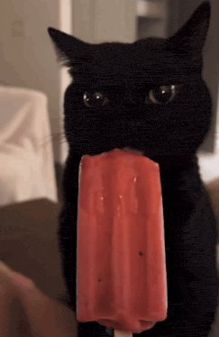

  

  

  <h1>ฅ^•ﻌ•^ฅ Hi, I'm NeoNekooo 🐈‍⬛</h1>

  

  

 

### 🐈‍⬛ About This Cat
- 🐾 **Bio:** *I'm a cat* yang suka eksplorasi kode, web development, dan arsitektur aplikasi.
- 💻 **Fokus:** Front-end engineering dengan Vue/TypeScript dan backend web berbasis Laravel.
- 🐟 **Favorit:** Coding santai, es krim semangka, dan begadang.
- 🎯 **Motto:** *"Purr-fect code, zero bugs, infinite coffee."*

 

### 🛠️ Tech Stack & Arsenal

  

 

### 📊 Cat Activity & Metrics

  
  

 

  

 

### 🐾 Reach The Cat

  
  

